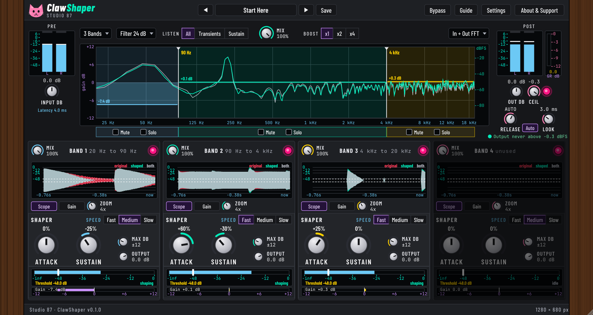

# ClawShaper

Multiband transient shaper with a safety limiter. Free and open source.

The real plugin window.

## Status
Test build (VST3 for Linux, Windows and macOS), v0.1.0. The window is the approved mockup ported natively to JUCE. It has not been checked on real machines yet, so treat it as a test. Download the zip from the [Releases](https://github.com/SpeakingColors/clawshaper/releases) page: installers, uninstallers and the manual (PDF) are inside.

## Controls
Input dB, 1 to 4 bands with draggable crossovers, Filter slope 12 to 96 dB/oct, Listen (All, Transients, Sustain), Mix, Boost x1/x2/x4, FFT view, per band Attack, Sustain, Speed, Threshold, Max dB, Output, Mix, Mute, Solo, Scope and Gain views, Out dB, a lookahead limiter (Ceil, Release, Auto, Look), 19 factory presets, your own presets, Bypass.

Every control has a hover info bubble.

## Try the mockup
Open `docs/mockup/ClawShaper.html` in a browser. Nothing is sent anywhere; it works offline (fonts load from Google Fonts when online, with a fallback).

## Build
`cmake -S . -B build -DCMAKE_BUILD_TYPE=Release && cmake --build build` (needs the usual JUCE Linux packages). Core DSP tests: `sh tests/run.sh`.

## Privacy
Collects nothing. No network access.

## Support

  

Free and open source, made by one person. If it helps your music, a coffee on [Ko-fi](https://ko-fi.com/studio87) keeps it coming.

## License
AGPL-3.0-or-later, see [LICENSE](LICENSE).
